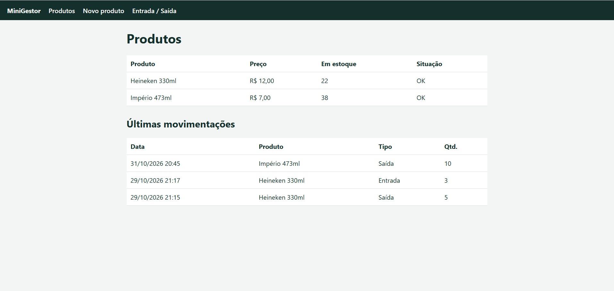

# MiniGestor

Sistema web de controle de estoque para pequenos negócios, feito com Python e Django.



## O problema
Em pequenas empresas, o estoque costuma ficar em planilhas soltas ou na memória do dono. Isso leva a falta de produto, compra em excesso e perda de vendas.

## A solução
Um sistema simples que mostra o estoque em tempo real e atualiza as quantidades sozinho a cada entrada ou saída.

## Funcionalidades
- Cadastro de produtos com preço e estoque mínimo
- Registro de entradas e saídas, com atualização automática da quantidade
- Bloqueio de saídas maiores que o estoque disponível
- Alerta visual de estoque baixo
- Histórico das últimas movimentações
- Painel administrativo (Django Admin) com movimentações protegidas contra edição
- Testes automatizados da lógica de estoque

## Tecnologias
Python 3, Django, SQLite, HTML e CSS.

## Como rodar
```bash
python -m venv .venv
.venv\Scripts\activate
pip install -r requirements.txt
python manage.py migrate
python manage.py createsuperuser
python manage.py runserver
```
Abra http://127.0.0.1:8000

## Testes
```bash
python manage.py test
```

## Próximos passos
- Módulo de vendas, que baixa o estoque automaticamente
- Módulo de fluxo de caixa com gráficos
- Login e relatórios mensais

## Autor
Joedson dos Santos Araujo